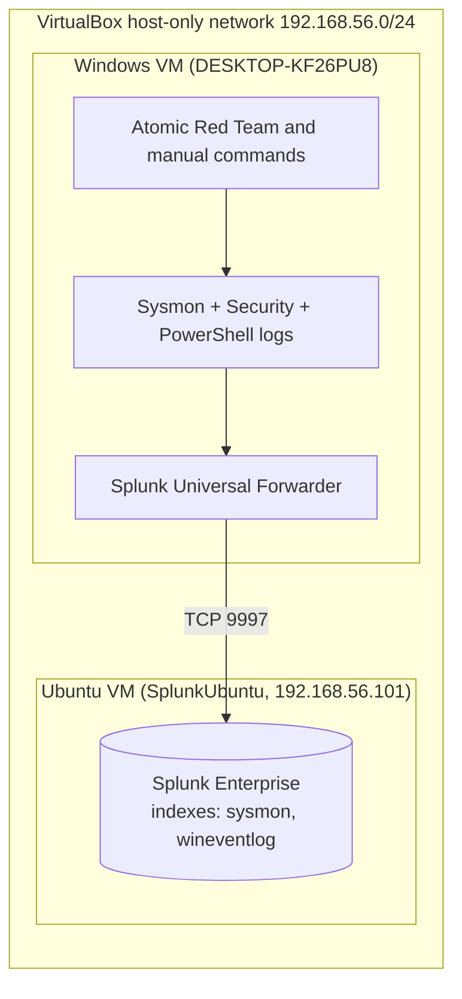

# Splunk Detection Engineering Lab

A home SOC lab that forwards Windows endpoint telemetry (Sysmon, Security, and PowerShell logs) into Splunk Enterprise, then runs attacker techniques against the endpoint and builds detections for each one, mapped to MITRE ATT&CK.

Each detection documents the attack that was run, the raw evidence, the search logic, false positives I actually observed, and ways an attacker could evade it.

> **Status:** 4 detections validated against lab data. Scheduled alerts, a dashboard, and 2 draft detections are in progress. See [Status and roadmap](#status-and-roadmap).

## What this demonstrates

- Building a log pipeline end to end: Sysmon, Windows Event Logs, Splunk Universal Forwarder, Splunk indexes
- Writing and validating detections in SPL, and expressing the same logic as vendor-neutral Sigma rules
- Mapping detections to MITRE ATT&CK techniques and data sources
- Triage and false-positive analysis, using evidence from my own lab data
- Troubleshooting a real deployment (see [`setup/troubleshooting.md`](setup/troubleshooting.md))

## Architecture



More detail in [`docs/architecture.md`](docs/architecture.md).

## Lab environment

| Component | Details |
|---|---|
| Hypervisor | Oracle VirtualBox |
| SIEM | Splunk Enterprise 10.6.0.5 (60-day trial license), on an Ubuntu VM |
| Endpoint | Windows VM, hostname `DESKTOP-KF26PU8`, local account |
| Telemetry | Sysmon (SwiftOnSecurity config), Windows Security log, PowerShell Operational log (script block logging) |
| Forwarding | Splunk Universal Forwarder 10.6.0.5 to TCP 9997 |
| Attack simulation | Atomic Red Team (Invoke-AtomicRedTeam) plus manual commands |
| Indexes | `sysmon`, `wineventlog` |
| Network | Host-only adapter for lab traffic, NAT adapter for setup and downloads |

<!-- VERIFY before publishing: Windows version/edition on the victim VM, and which Splunk add-ons (Sysmon, Windows) are installed. -->

## ATT&CK coverage

| Technique | Name | Tactic | Data source | Status |
|---|---|---|---|---|
| [T1136.001](detections/T1136.001-create-account/) | Create Account: Local Account | Persistence | Sysmon EID 1, Security 4720 | Validated, alert pending |
| [T1059.001](detections/T1059.001-encoded-powershell/) | Command and Scripting Interpreter: PowerShell | Execution | Sysmon EID 1, PowerShell 4104 | Validated, alert pending |
| [T1053.005](detections/T1053.005-scheduled-task/) | Scheduled Task/Job: Scheduled Task | Persistence, Privilege Escalation, Execution | Sysmon EID 1 | Validated, alert pending |
| [T1110.001](detections/T1110-brute-force/) | Brute Force: Password Guessing | Credential Access | Security 4625 | Validated (manual simulation), alert pending |
| [T1547.001](detections/_drafts/T1547.001-registry-run-key/) | Registry Run Keys / Startup Folder | Persistence | Sysmon EID 13 | Draft, untested |
| [T1070.001](detections/_drafts/T1070.001-clear-event-logs/) | Indicator Removal: Clear Windows Event Logs | Defense Evasion | Security 1102, Sysmon EID 1 | Draft, untested |

"Validated" means the search returned the simulated activity in my lab data. It does not mean the rule has been tested against production-scale noise.

## Key findings

1. **A loose wildcard produced a false positive.** My first process-creation search for `net user /add` (`CommandLine="*user*/add*"`) also matched the forwarder install adding a service account to the "Performance Monitor Users" group, because "Users" contains "user". I documented it and tightened the logic.
2. **Account names in 4720 events are multivalue.** `TargetUserName` and `SubjectUserName` came back blank. The values were in a multivalue `Account_Name` field, so I extracted them with `mvindex()`.
3. **The default forwarder service account could not read the Sysmon log.** Security and PowerShell logs arrived, but the `sysmon` index stayed empty until the service ran as Local System.
4. **Not every Atomic test fits a standalone VM.** The T1110.001 atomics target Active Directory, so I simulated password guessing manually against a workgroup machine and said so in the write-up.

## Repository layout

```
splunk-detection-lab/
├── README.md
├── setup/              lab build guide, inputs.conf, troubleshooting log
├── detections/         one folder per technique (README, SPL, Sigma, screenshots)
│   └── _drafts/        written but not yet validated
├── incident-report/    SOC-style write-up built from the lab events
└── docs/               architecture, screenshot checklist, publishing guide, lessons learned
```

## How to reproduce

Follow [`setup/README.md`](setup/README.md). Expect roughly two to three weekends, most of it spent in the attack, detect, and tune loop.

## Safety

All attack simulations ran in an isolated lab on virtual machines I own, on a host-only network. Nothing here should be run against systems you do not own or have written permission to test.

## Status and roadmap

- [x] Log pipeline working (Sysmon, Security, PowerShell into Splunk)
- [x] 4 detections validated with evidence
- [ ] Save scheduled alerts and capture them firing (do this inside the 60-day trial window)
- [ ] Build and test the dashboard
- [ ] Validate the 2 draft detections
- [ ] Add more detections (LOLBins, credential access, network-based)


## Author

Daniel Guy. [LinkedIn](https://www.linkedin.com/in/dguy2003) | [GitHub](https://github.com/DGUY1-wilm)
