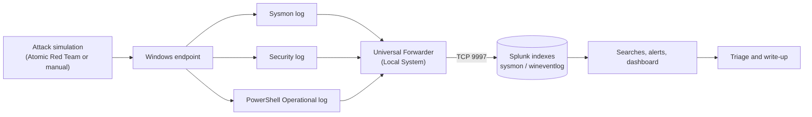

# Architecture

## Components

| Component | Role |
|---|---|
| **Windows VM** (`DESKTOP-KF26PU8`) | Endpoint that attacks are run against. Produces Sysmon, Security, and PowerShell logs. |
| **Sysmon** (SwiftOnSecurity config) | Detailed endpoint telemetry: process creation, registry changes, file creation, network connections. |
| **Splunk Universal Forwarder** | Reads the Windows event logs and sends them to Splunk on TCP 9997. Runs as Local System. |
| **Ubuntu VM** (`SplunkUbuntu`, `192.168.56.101`) | Runs Splunk Enterprise: receives, indexes, and searches the data. |
| **Atomic Red Team** | Library of small attack simulations mapped to ATT&CK techniques. Some tests were replaced with manual commands. |

## Data flow

## Networking

Each VM has two adapters:

- **Adapter 1, NAT:** internet access for downloads and updates.
- **Adapter 2, Host-only:** the private lab network (`192.168.56.0/24`) where the forwarder reaches Splunk and where the host PC can open Splunk Web at `http://192.168.56.101:8000`.

After setup, the NAT adapter on the Windows VM can be disabled while running attack simulations.

## Indexes and sources

| Index | Sources |
|---|---|
| `sysmon` | `Microsoft-Windows-Sysmon/Operational` |
| `wineventlog` | `Security`, `Microsoft-Windows-PowerShell/Operational` |

## Snapshots used

`clean-install` (fresh Windows), `sysmon-installed`, `logging-working` (pipeline verified), `atomic-ready` (Atomic Red Team installed). Revert between tests so each starts from a known state.

<!-- Optional: replace or supplement the Mermaid diagram with a drawn diagram saved as architecture.png -->
